<p align="center">
  
</p>

# NOTORYX Core

Part of the **NOTORYX** off-grid communications family. **No Towers. No Limits.**

> NOTORYX Core was previously named Bastion. Its package ID (`com.bastionmesh.bastion`) and Android signing key are unchanged, so existing installs update in place and keep their data.

**Off-grid messaging, check-ins and SOS over your MeshCore LoRa radio.**

NOTORYX Core turns your phone or computer and a [MeshCore](https://meshcore.io/) radio into a field communicator that works without cell service, Wi-Fi or the internet. Messages hop from radio to radio across the mesh.

<p align="center">
  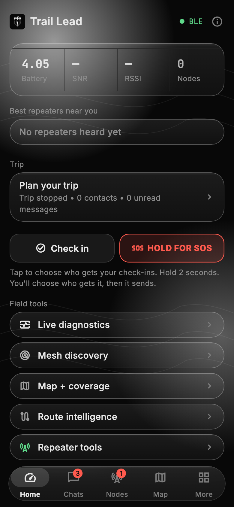
  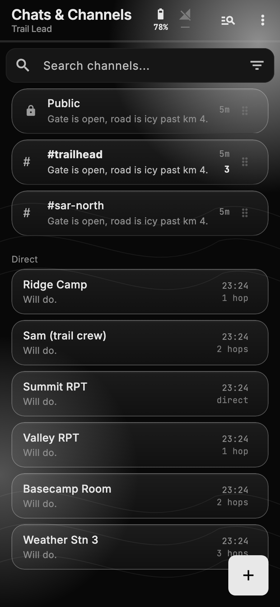
  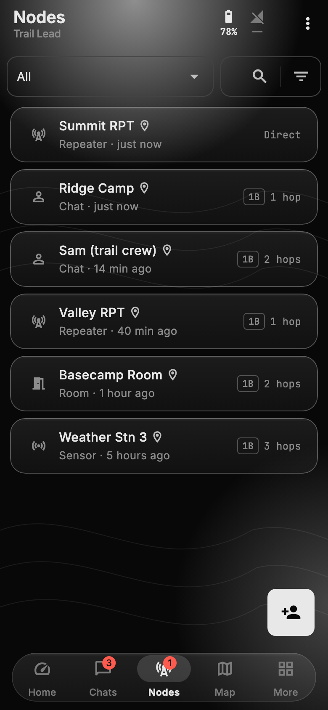
  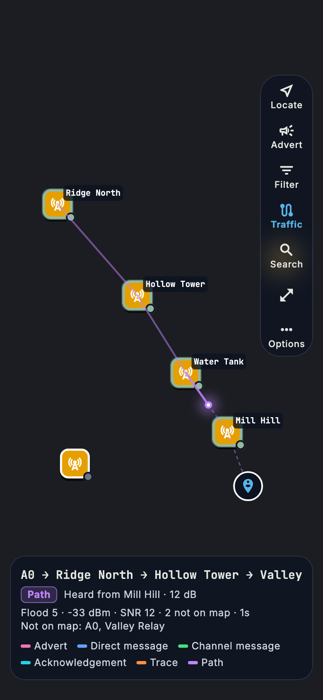
</p>

> **Latest stable: [10.0.0](https://github.com/TheLogsAreScreaming/notoryx-core-releases/releases/tag/v10.0.0)** (14 November 2026). **Latest pre-release: [10.1.0-rc.16](https://github.com/TheLogsAreScreaming/notoryx-core-releases/releases/tag/v10.1.0-rc.16)** (21 November 2026), with SARNEG code words, the rebuilt wardrive, up to 5,000 remembered nodes, the live traffic map, stale-node badges, range rings and the on-device spam filter. The new **BLACKOUT** look and app icon shown here are merged and arrive in the next build.
>
> NOTORYX Core is checked by automated tests and a mesh simulator but not yet on a wide range of phones and radios: see [Known limitations](docs/KNOWN_LIMITATIONS.md). It is not a replacement for an emergency service or a satellite messenger. Please [report problems in notoryx-core-releases](https://github.com/TheLogsAreScreaming/notoryx-core-releases/issues/new/choose) (issues are off in this source repository).

## Download

Get the latest build from **[NOTORYX Core releases](https://github.com/TheLogsAreScreaming/notoryx-core-releases/releases)**. Each release lists what changed. Pre-releases (10.1.0-rc.*) get new features first; 10.0.0 is the latest stable build.

| Platform | File | Notes |
|---|---|---|
| Android (ARM64 phones) | `NOTORYX-Core-…-arm64-v8a.apk` | Signed with the existing release key |
| Android, Lite | `NOTORYX-Core-Lite-…-arm64-v8a.apk` | Smaller, with no closed-source parts: no on-device translation, picture messages, camera QR scanner or phone GPS. Signed with the same key |
| macOS (Intel and Apple silicon, macOS 14+) | `NOTORYX-Core-…-macOS-universal.zip` | Not notarized by Apple (see below). The newest Mac build is 10.1.0-rc.10: rc.11 to rc.16 are Android-only while a build dependency's download server is fixed |

iOS, Windows, Linux and web builds compile in CI but aren't released yet.

### Install on Android

**Easiest: get updates automatically with [Obtainium](https://obtainium.imranr.dev/).** On your phone, install Obtainium, then tap the badge below. It adds NOTORYX Core with pre-releases included and the Android APK picked out, and tells you when a new build is out.

<p><a href="https://apps.obtainium.imranr.dev/redirect?r=obtainium://app/%7B%22id%22%3A%22com.bastionmesh.bastion%22%2C%22url%22%3A%22https%3A%2F%2Fgithub.com%2FTheLogsAreScreaming%2Fnotoryx-core-releases%22%2C%22author%22%3A%22TheLogsAreScreaming%22%2C%22name%22%3A%22NOTORYX%20Core%22%2C%22additionalSettings%22%3A%22%7B%5C%22includePrereleases%5C%22%3Atrue%2C%5C%22apkFilterRegEx%5C%22%3A%5C%22arm64-v8a%5C%5C%5C%5C.apk%24%5C%22%2C%5C%22autoApkFilterByArch%5C%22%3Atrue%2C%5C%22versionDetection%5C%22%3Atrue%7D%22%7D"></a></p>

Or install the APK yourself:

1. On your phone, open the release and download the `.apk`.
2. Open the file. If Android asks, allow installs from your browser or file manager.
3. Open NOTORYX Core and allow **Bluetooth**, **location** and **notifications** when asked.

**Upgrading from a test build:** builds before 10.0.0-rc.10 were signed with a temporary test key, and Android won't install a release-signed build over them. First make an encrypted backup (**More → Encrypted backup**), then uninstall the old app, install the new one and restore. You only do this once. Later versions install as normal updates.

### Install on a Mac

1. Download the `.zip` from the release and double-click it to unzip.
2. Drag **NOTORYX Core** into your **Applications** folder.
3. Open it. The first time, macOS says it can't check the app for malicious software, because it isn't notarized by Apple.
   - Click **Done**, then open **System Settings → Privacy & Security**.
   - Scroll down and click **Open Anyway** next to "NOTORYX Core was blocked", then confirm.
   - You do this once for each new version.
4. Allow Bluetooth when asked.

Each release includes `SHA256SUMS-Android.txt` and `SHA256SUMS-macOS.txt` (and, from 10.1.0-rc.2, `RELEASE-MANIFEST.json`) if you want to check your download (`shasum -a 256 <file>`). How each published file is tied to its source commit, its test run and the signing certificate is described in [Release provenance](docs/RELEASE_PROVENANCE.md).

## Getting started

1. **Connect your radio.** On the home screen, tap **Get started**, or go to **Connect radio**. NOTORYX Core connects over Bluetooth, USB or TCP to a radio running MeshCore companion firmware. Turn on **Connect to my radio automatically** and it reconnects to your last radio when the app opens.
2. **Say hello.** Open **Chats** and send a message on a channel, or open someone in **Nodes** to message them directly.
3. **Choose who gets your check-ins and SOS.** Tap **Check in: I'm OK** or hold **SOS**. The first time, NOTORYX Core asks who should get them. You can change this anytime in **Plan your trip**.
4. **Add more radios (optional).** **Add a radio** on the **Connections** screen (from **Connect radio**) keeps a second radio, such as a handheld and a base station, connected at the same time. The app shows and sends through the radio in use; the radio switcher at the top of **Home** changes it. The others stay connected and save their messages for when you switch.
5. **Set your radio for your area.** **Settings → Radio settings → Presets** lists MeshCore's community presets (USA, Canada, EU/UK, Australia and more) with the one for your country suggested first.
6. **Pick a look.** **Settings → Theme** offers five themes: BLACKOUT (default), Tactical, Okabe-Ito (color-blind safe), Night Ops (low light) and Seasonal. You can set a second theme for when your phone is in dark mode, and **Theme → Background** puts a color, gradient or your own photo behind the glass panels.

The tabs at the bottom are **Home**, **Chats**, **Nodes**, **Map** and **More**. Home is where check-in, SOS and your radio's readings live; **More** holds every tool and setting, with a search box. Every coverage and map tool is in one place, **More → Map + coverage**.

## Features

### Safety and trips
- **SOS:** hold for 2 seconds to send your radio's position to your trip contacts (and an optional channel). It repeats every 5 minutes until someone replies or you stop it, and **I'm safe** sends an all-clear.
- **Signed SOS:** an SOS on a channel carries a signature from your radio's own key, so other NOTORYX users can see it really came from you. You can sign every channel post too. A post whose signature doesn't check out is shown as unverified, and other apps just see the normal message.
- **SOS relay** (optional, off by default): when your radio hears an SOS straight from the sender and no repeater passes it on, NOTORYX sends it once more so it can reach a repeater the sender can't. Needs radio firmware v1.16 or newer, and is not yet field-tested on radios.
- **Check-ins:** I'm OK, At camp, Delayed and Heading back. You see who each one reached, and can resend to anyone it missed. Check-ins can also go to a team or SAR channel, signed with your radio's key.
- **Check-in reminders and overdue alerts:** a notification when you're due to check in, and a warning when a trip contact goes quiet for longer than you set.
- **Trip planning:** pick up to six contacts. Trip briefs, a Field Log of everything sent and received, and optional automations.
- **Trip readiness:** a **Ready** card before you leave checks your radio, battery, offline maps and SOS contacts, and says what's left to fix (for example *SOS can't reach anyone*).
- **SALUTE and 9-Line reports** from the SOS panel and the check-in card, filled in with your position and the time in UTC, and split into numbered messages when they're long.
- **Team tracking:** share your position on a private channel during a trip, every 10 to 60 minutes, only when you've moved. **Day replay** (Map + coverage) plays back where everyone went on a chosen day.
- **Zone and off-trail alerts:** alert when someone enters or leaves an area around you or a waypoint, or strays from a route or recorded track.
- **Checklists:** offline checklists (*Before a trip* and *Putting up a node* to start) with timestamped records you can export.
- **SOS on the lock screen:** with app lock on, the 2-second SOS hold still works without unlocking, and an SOS keeps going after the app restarts.
- **Android home-screen widget:** radio status, battery and unread count, with one-tap Check in and SOS.

### Messaging
- Direct and channel messages with delivery status, reactions, GIFs and image messages. Tapping a notification opens that chat.
- **Find channels:** a directory of public hashtag channels (local ones first), channels heard on air that you haven't joined, and **Active online**: the #channels an online analyzer has seen in use, with one-tap Join.
- **Message search**, per-chat **drafts**, **read aloud** and on-device translation.
- **Spam filter** for channel chats, on the device: hides likely spam, and you can mark a post as spam or not spam. SOS and emergency posts are never filtered. **Reset routing** puts the radio's routing settings back to their defaults.
- **Reply to a message** in channels and direct chats (shown as a quote), **@mentions** with name suggestions, and **block** a sender on a channel.
- **Reply from the notification** without opening the app. A reply that can't go out yet is saved as a draft.
- **Offline queue:** messages written while your radio is disconnected wait above the message box and go out when it reconnects. Chats stay open while a dropped link reconnects.
- **Forward** a message to another chat, and **schedule** one: hold Send and pick a time up to 30 days ahead.
- **Not delivered:** when your last message to someone didn't get through, their row in **Nodes** says so; tap it to see why and fix it.
- **Airtime estimate** under the message box (for example `≈0.6 s on air`), worked out from your radio's settings.
- **Per-channel notifications:** all messages, only when you're mentioned, or muted. A message that arrives twice alerts only once.
- **Quick messages:** ready-made replies like "On my way" or "At camp" from the message box menu. Edit the list to make it yours.
- **SARNEG code words** (Tools → SARNEG code word): send grid references, frequencies and times as letters instead of digits. Your team agrees on a 10-letter word with no repeated letter (with BLACKHORSE, `[SARNEG] LRs KSAC` reads as 17S 4823). A SARNEG button in the message box codes the numbers before you press Send, and a received `[SARNEG]` message gets a tap-to-decode line. Share the word by QR code or text, and set a different word for given days. The same format works in every NOTORYX app. It keeps numbers away from a casual listener; it is **not encryption**. The SARNEG screen blocks screenshots, numbers you encode or decode by hand there clear after a minute without typing, and anything copied from it is wiped from the clipboard after a minute.
- **Direct messages:** stop retrying a message that's still being sent, and a note in a new chat that the other person has to add you as a contact before they can read and answer.
- **Share your position or a contact** from the message box. Received contacts can be added in one tap, and **Add contact from clipboard** accepts links, adverts (even wrapped across lines) and bare public keys.
- **Discovered contacts:** add one with a tap, or long-press to pick several (or **Add all shown**) and add them together, up to the room left on your radio.
- **Remembers up to 5,000 heard nodes**, including contacts your radio drops when its list is full, and **Import nodes** reads a JSON or CSV list, contact links, adverts or public keys from a file or the clipboard. **Nodes** on Home counts everything the app knows, with how full your radio's contact list is.
- **Region tags:** a channel post scoped to a region shows it next to the time, for example **📍 ct**.
- **Link previews** (off by default, since fetching one tells the site your IP address).
- **Area-limited channel messages** that stay within a radius of you. These need radios running flood-corridor firmware.
- Optional auto-delete of old channel messages.

### Maps, paths and coverage
- Live mesh map with offline map packs, a button to jump to your position (phone GPS, or your radio's), and a **track log** that records your trail and exports GPX. **Favorites only** hides every node you haven't starred, and **Map as a list** lists nodes and waypoints nearest first for screen readers.
- **Waypoints and routes:** save places, import GPX, KML or GeoJSON, export GPX, and see them on the map.
- **Offline trail routing and place search:** download an area's trails and named places (peaks, huts, springs, trailheads and more) from OpenStreetMap, then plan the shortest route along trails with no signal.
- **Live traffic map:** turn on **Traffic** to see each packet your radio hears drawn hop by hop, from where it started through each repeater to you, coloured by type.
- **Stale nodes and range rings:** nodes not heard for a time you choose get a stale badge and fade on the map, and the map can draw distance rings around your position.
- **Compass to any node:** **Point me to it** on a node opens a compass with an arrow, distance and "Turn left 35°". It opens from the map, the Nodes list and the path tools.
- **Coordinates** as decimal degrees, DMS, MGRS, UTM or Maidenhead locator.
- **Map telemetry:** battery, temperature, humidity or pressure badges on the map. Readings dim after an hour and hide after a day, and the map remembers your choice.
- **Wardrive:** ping as you drive or hike and map which repeaters heard you, and how well, both ways. Four modes: **Discovery** (zero-hop, the default), **Trace** (one repeater, measured both ways), **Channel** (a short post to #wardriving; it floods the mesh, so it's never the default and no position goes on air) and **Hybrid**. Packets your radio hears anyway are mapped too, at no airtime cost. Pings wait until you've moved and skip squares heard recently. The map is coloured in 100 m or 300 m squares (both ways, repeater only, passive, no answer, skipped), with per-repeater stats, a noise-floor graph, export to GPX, KML, CSV or GeoJSON, and an option to keep running with the screen off. Drives are saved.
- **Network scan** (More → Networks): find MeshCore networks nearby. A radio only hears networks on its exact settings, so a scan switches yours to each network in turn and switches back. **Quick** (the default) sends one zero-hop discover ping on each and listens about 8 s, so a scan takes well under a minute; **Thorough** only listens, 30–90 s each, and also finds networks without a repeater in range. The first scan checks every preset in your band; after that, the networks you've found and saved plus your country's preset. Each network heard is logged with the time, place, signal and its nodes, so you can map it, export CSV or GPX, save it, or join it with one tap. You're off your own mesh while it scans, so it won't run during an SOS or a trip, and the radio's auto-add is paused so other networks' nodes don't fill your contacts.
- **Path graph:** every path you've heard, drawn as flows from far repeaters to you, or as a **network** diagram with you in the middle. Short (1-byte) hops are matched to a specific repeater using longer paths, and the app remembers which repeater wins a shared short ID.
- **Route Intelligence:** learned routes and the best repeaters your radio hears directly. **Route view** shows each link of a contact's route with the signal both ways, and lets you pick a different route.
- **Trace card:** share a finished path trace as a card.
- **Node journal:** every node your radio has ever heard, with first and last heard, how far away, labels, tags and your own notes. **Timeline** puts messages, new nodes, signal changes and places in one feed.
- **Mesh health:** a plain-words grade of your local mesh, warnings when a route is getting worse, and alerts when a favorite repeater goes quiet or a new one shows up nearby.
- **Observer reach:** check which online observers heard a message you sent, how many hops it took and the best signal. Repeaters you don't have as contacts can be named online. Both use a CoreScope analyzer you choose in Settings.
- **Coverage hexagons:** record where your radio got through and upload to your own HTTPS endpoints, with a privacy delay. Each observation is signed, so edited or fake reports can be rejected.
- **Antenna coverage** over the terrain with estimated signal strength, and coverage capture sessions.
- **Line of sight** with the **Fresnel zone** shaded, so you can see when a path is clear of the ground but still too close to it to work well.

### Your radio
- **Sensors on Home:** your radio's own readings (battery voltage, temperatures, GPS, light and whatever else it reports).
- **Radio presets:** MeshCore's community catalogue with search and a suggestion for your country. Choosing one keeps your transmit power. Local mesh settings (for example Phoenix's or Philadelphia's) are offered when your radio, or your phone if the radio has no position, is in that area; see [adding your area](#add-your-areas-mesh-settings).
- **Send your advert** zero-hop (only radios that hear you directly) or flooded across the mesh.
- **Several radios at once:** stay connected to more than one radio and switch between them. Each keeps its own messages, queue and unread count, and each reconnects at launch.
- **Radio features:** see which optional features your radio's firmware supports, and why a control is missing.
- **Identity key backup:** show and copy your radio's private key, or restore one, so a replacement radio keeps your identity.
- **Firmware update guide:** shows your radio's firmware and board and checks for a newer MeshCore release (only when you tap). The app never flashes firmware itself.
- Connections dashboard, live radio stats and a noise-floor chart, adjustable refresh rate and battery saver. On Android, Settings shows whether battery optimization can stop the app in the background.
- Command line and Wi-Fi setup for your own radio. With permission, you can also use a trusted contact's command line.

### Field tools
- **Nearby repeater test:** one tap shows which repeaters hear your radio directly.
- **Battery watch:** 30 days of each repeater's battery voltage, a trend that says how sure it is, and timed checks of the repeaters you choose with an alert when one is falling.
- **Repeater ping:** a one-hop trace showing the signal both ways. **Antenna hunt:** clicks faster as a chosen repeater gets louder.
- Repeater and room-server tools: login, status, neighbors, telemetry, command line and **access control**.
- **Forget last advert** on a contact, for a node whose adverts stopped updating after its clock was reset.
- **Repeater IDs** (who uses an ID, which are free) and **Region setup** (US and Canada region trees, or your own) for repeater owners.
- **Bot Mode:** local auto-replies, keyword rules and commands like `!ping`, `!sun`, `!moon`, `!weather`, `!dice` and `!trace`, in direct messages and in the channels you choose. It can also post weather alerts to a channel.
- **Automation rules:** when the battery drops, at a time of day, when you enter or leave an area, when a node is heard or goes quiet, or when a message arrives (combine them with AND or OR), post a notification, send a message, or call a webhook you opt in to.
- **Field guide** and app-icon shortcuts.

### Privacy and security
- **App lock** with your fingerprint, face or screen lock. Radio and alerts keep running while it's locked.
- **Encrypted storage** (optional): message history, contacts, channel keys, waypoints, drafts and queued messages, with a random key in the phone's secure storage.
- **Encrypted backup and restore**, including your message history (merged, not replaced). A restore is all or nothing.
- **Team setup:** share radio settings, channels, waypoints and routes by QR code or file, always passphrase-encrypted.
- **Privacy page** (More → Privacy) explains what the mesh can see and what stays on your phone.
- **Community moderation** (off by default): report spam to human moderators. Nothing is sent until you turn it on.

### MQTT bridge (optional)
- **Several brokers at once** over TLS or secure WebSocket, with a Wi-Fi-only option and an offline queue that sends when you're back online. Broker passwords are kept in the system keychain.
- **Live packet feed.** Channel messages that reached you only over the internet are marked **via MQTT**, and never count as radio repeats.
- **Observer sharing** in the community `meshcoretomqtt` format. It's off until you turn it on, and direct messages and your own traffic each need a separate opt-in.
- **LetsMesh-style sign-in** with a token signed by your radio, so its private key never leaves it. LetsMesh (US and EU) and MeshRank presets are included; they're community services, not part of NOTORYX.

### Look and feel
- **BLACKOUT look:** matte black, charcoal and steel with frost-white text and the steel eagle-N app icon. The main screens sit on a soft glow with see-through glass panels and a floating tab bar. With reduce motion turned on, the blur is off.
- **Your own background:** the theme's glow, a flat color, a gradient, a soft color blend or your own photo, with dim and blur controls so text stays readable.
- **Node looks:** give any node a color or a photo. It shows in the Nodes list and on the map.
- **Dark-mode theme:** an optional second theme for when your phone is in dark mode.
- Five themes: **BLACKOUT** (matte black, steel and frost, the default; monochrome, with signal, warning and SOS colors kept), **Tactical** (olive, gunmetal and earth tones), **Okabe-Ito** (color-blind safe, on charcoal), **Night Ops** (dim reds on near-black for low light) and **Seasonal**, which follows the season by your device's date (spring, summer, autumn, winter, plus optional Halloween, Christmas and Valentine's Day colors) or a season you pick. Every theme meets WCAG AA contrast (4.5:1) for text, buttons, chat bubbles and SOS, and SOS stays red in all of them.
- **Color-blind safe colors:** node types on the map and in lists (people, repeaters, rooms and sensors) use the [Okabe-Ito palette](https://jfly.uni-koeln.de/color/), whose colors stay distinct with the common forms of color blindness. The **Okabe-Ito** theme goes further: good, warning and bad signal are blue-green, yellow and vermillion instead of green and red, and every accent comes from the same palette.

  | Orange | Sky blue | Bluish green | Yellow | Blue | Vermillion | Reddish purple | Black |
  |---|---|---|---|---|---|---|---|
  | `#E69F00` | `#56B4E9` | `#009E73` | `#F0E442` | `#0072B2` | `#D55E00` | `#CC79A7` | `#000000` |
- Available in 18 languages.

<p align="center">
  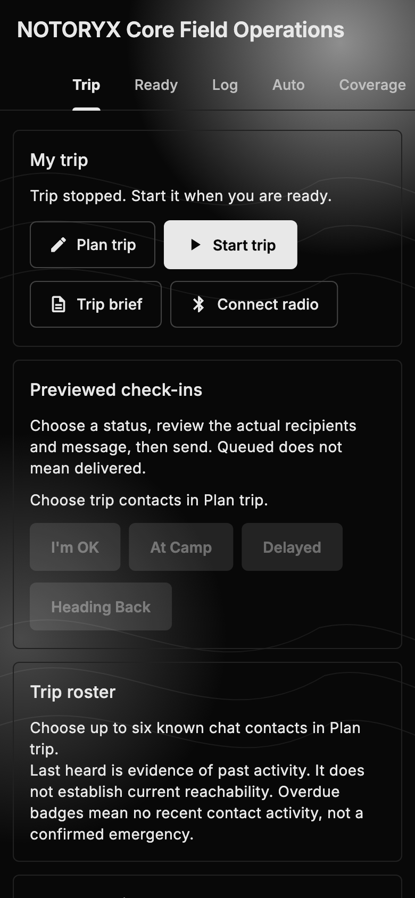
  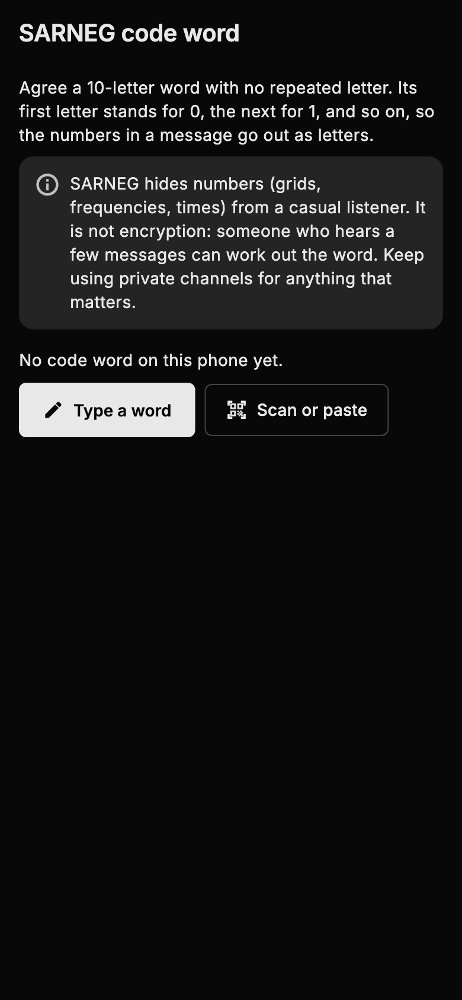
  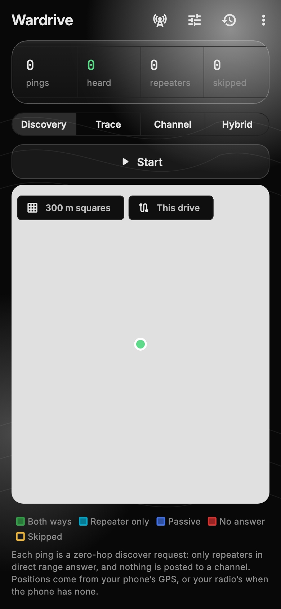
  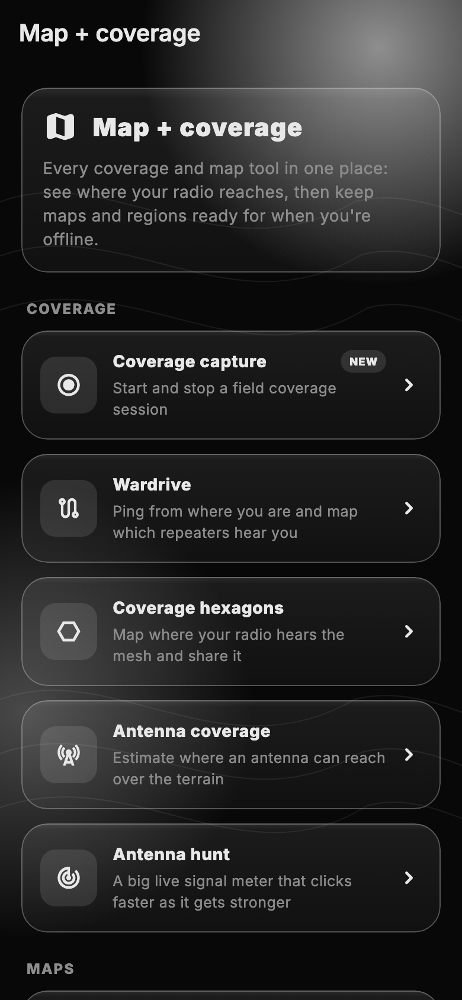
</p>

<p align="center">
  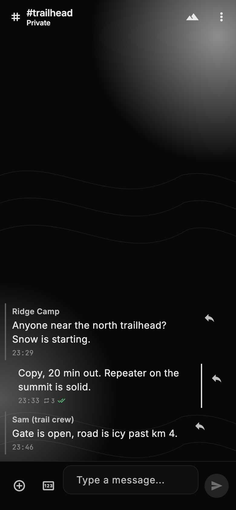
  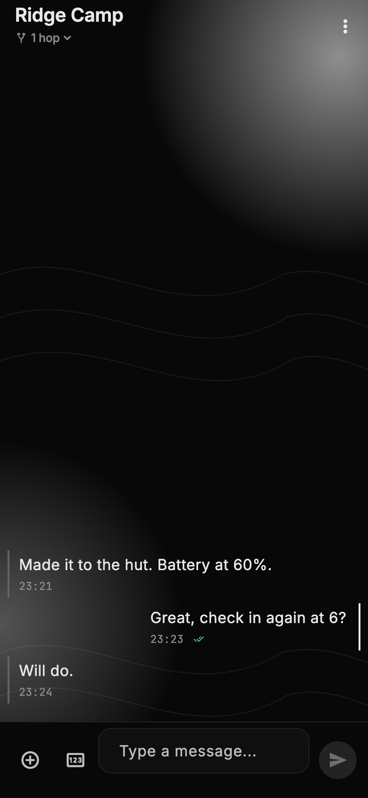
  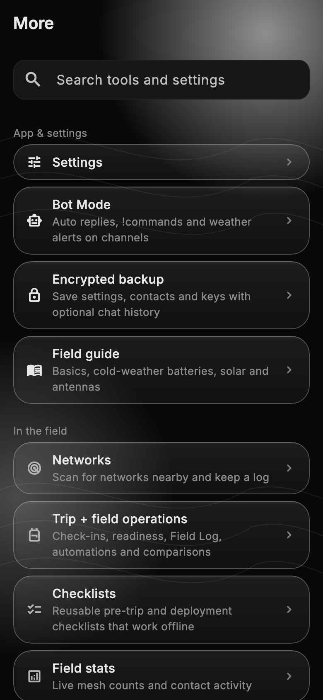
  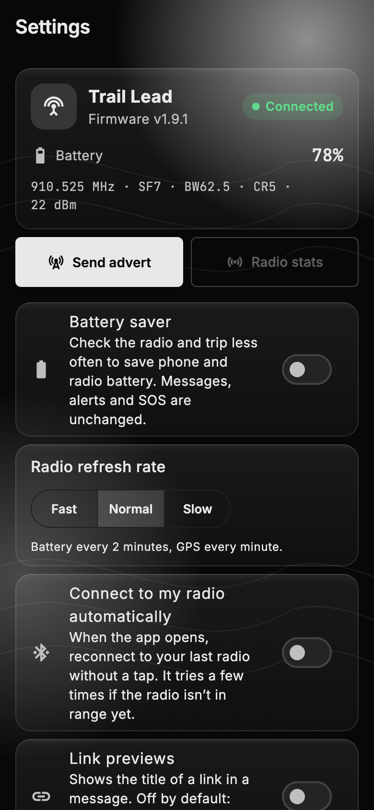
</p>

<p align="center">
  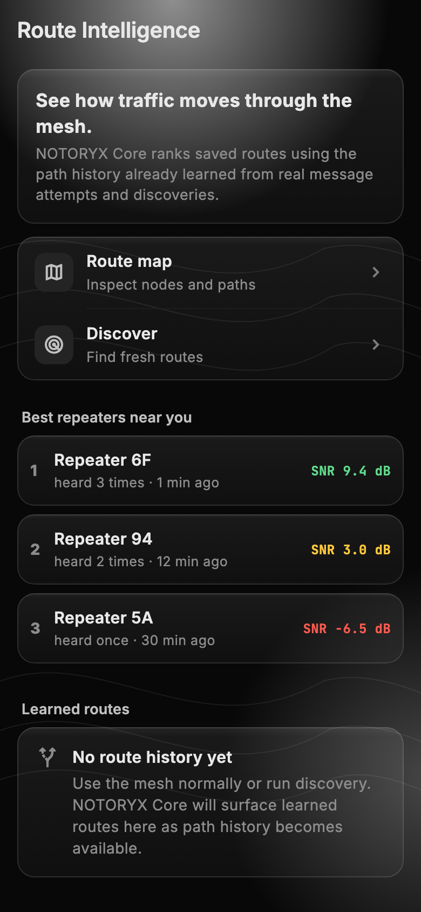
  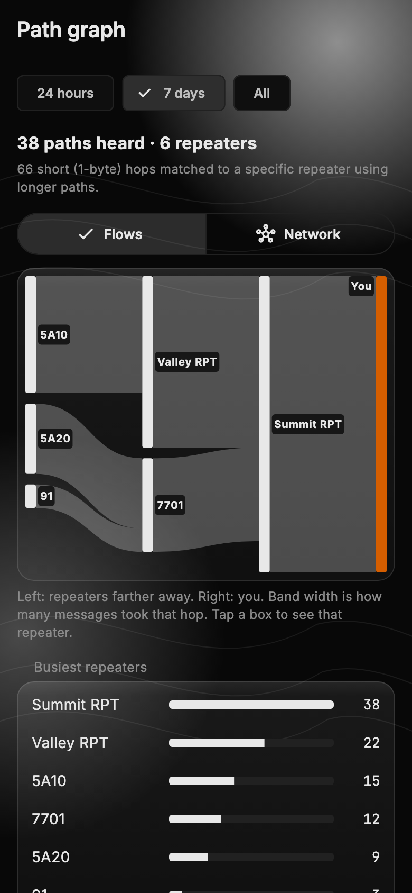
  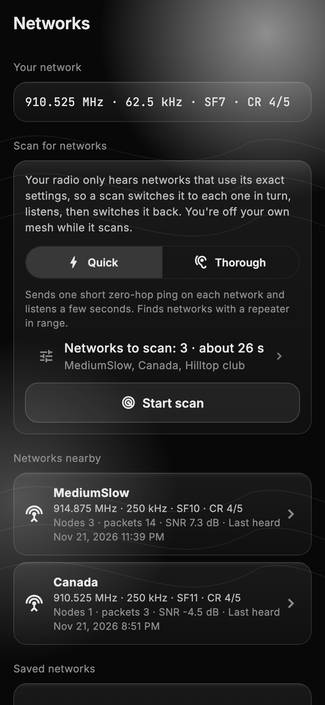
  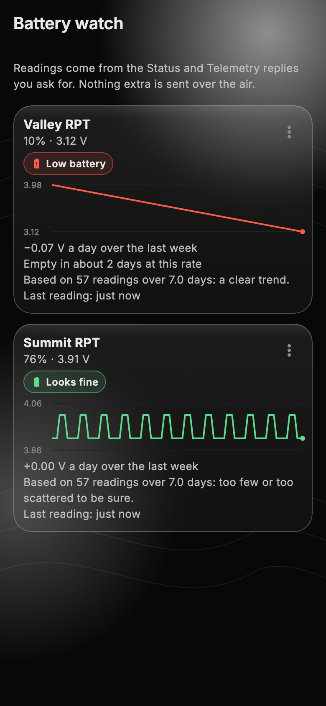
</p>

<p align="center">
  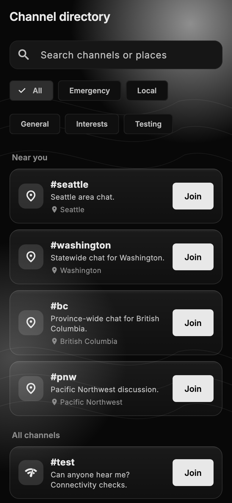
  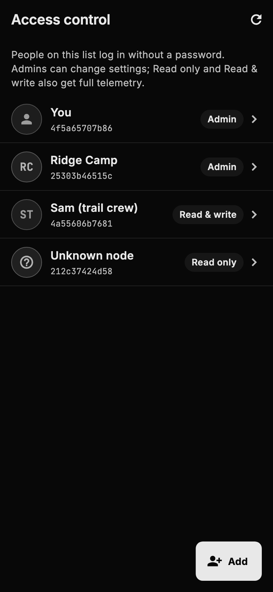
</p>

<p align="center">
  
  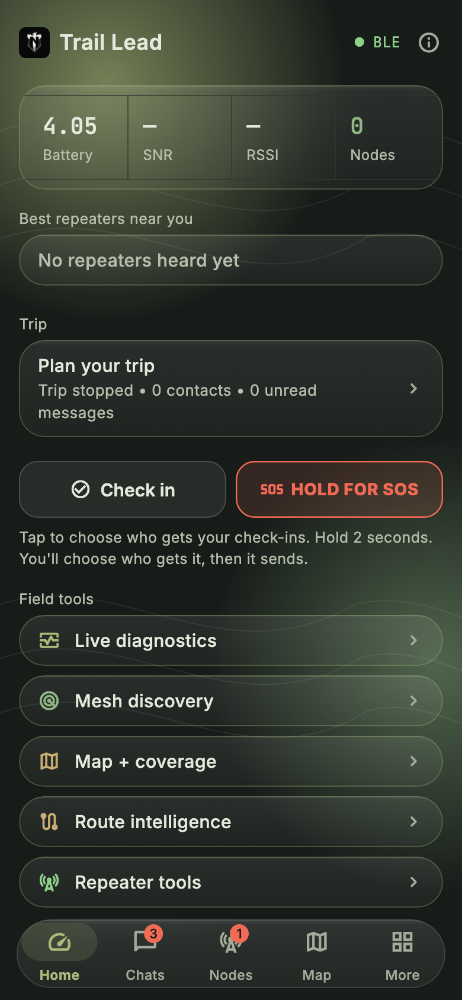
  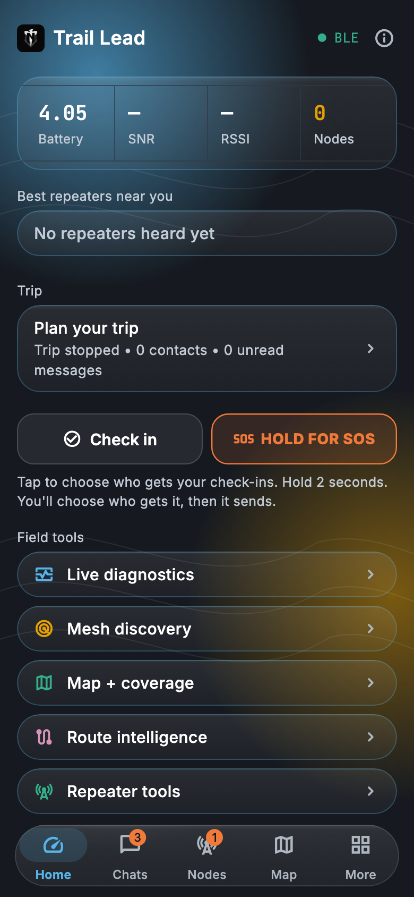
  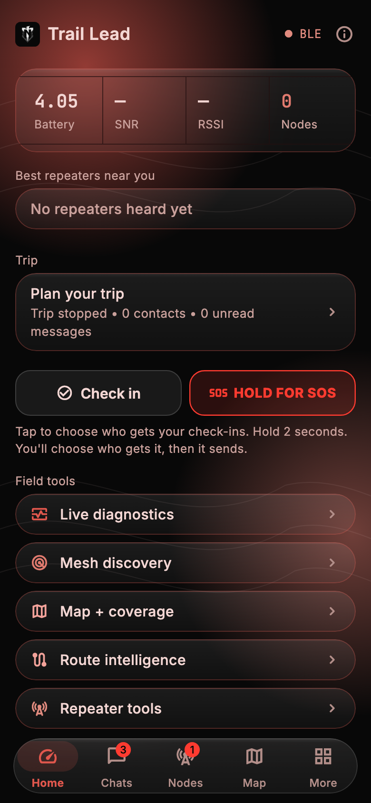
  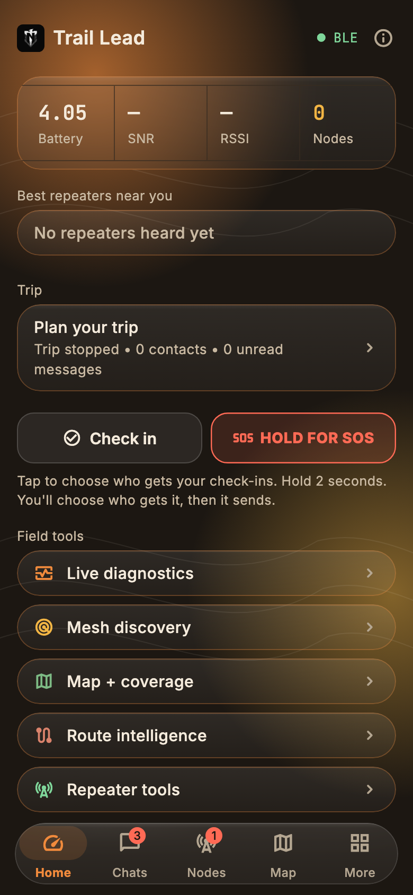
</p>
<p align="center"><em>BLACKOUT · Tactical · Okabe-Ito · Night Ops · Seasonal. Screenshots are rendered from the app with sample data (<code>test/preview/</code>), not captured on a phone.</em></p>

## Add your area's mesh settings

When a local mesh agrees on new radio settings, NOTORYX Core can offer them to everyone nearby. The live list is [`regional_presets.json` in notoryx-core-releases](https://github.com/TheLogsAreScreaming/notoryx-core-releases/blob/main/regional_presets.json), which NOTORYX Core checks every 12 hours. The app also bundles a copy, [`assets/regional_presets.json`](assets/regional_presets.json), for first launch and offline use; update it to match the live list before each release.

To add or update an area, [open an issue in notoryx-core-releases](https://github.com/TheLogsAreScreaming/notoryx-core-releases/issues/new). Each entry has:

```json
{
  "id": "us-philadelphia",
  "name": "Philadelphia",
  "center": [39.9526, -75.1652],
  "radiusKm": 100,
  "frequencyMHz": 919.5,
  "bandwidthKHz": 500,
  "spreadingFactor": 10,
  "codingRate": 5,
  "pathHashBytes": 2,
  "updated": "2026-10-17",
  "notes": "Where this comes from and anything people should know."
}
```

Please say in `notes` where the settings come from. Change `updated` whenever the settings change: that's what triggers the "settings changed" notification.

Most entries are worked out from the public [MeshCore map](https://map.meshcore.io), where node owners report their settings. These have `"source": "map"` and a node count, and the app labels them as reported, not checked on air. They leave out `pathHashBytes` because the map doesn't report it, so applying one doesn't change the radio's path hash size. They're made with [`tools/regional_presets`](tools/regional_presets/README.md), which only lists areas that differ from the usual settings for their part of the world. Hand-made entries (no `source`) are kept when the list is regenerated and win over a map area with the same settings. The file is `"version": 2`; older app versions ignore it and keep the list they have.

## Building from source

You'll need [Flutter](https://flutter.dev) 3.47 (stable).

```bash
flutter pub get
flutter run
```

Release builds:

```bash
flutter build apk --release --target-platform android-arm64
flutter build appbundle --release   # Google Play
flutter build macos --release
```

The Android application ID is `com.bastionmesh.bastion`.

Before opening a pull request, run:

```bash
dart format lib test
flutter analyze --fatal-infos
flutter test
```

### Project layout

- `lib/connector/`: MeshCore protocol and the Bluetooth, USB and TCP transports
- `lib/screens/`: app screens
- `lib/services/`: field ops, coverage, routing, MQTT, notifications and other services
- `lib/models/`, `lib/storage/`: data and persistence
- `lib/theme/`: themes and colors
- `test/`: unit and widget tests; `test/preview/` renders screenshots (`PREVIEW_OUT=dir flutter test test/preview`, with `PREVIEW_THEME=tactical`, `okabe_ito` or `night_ops` for other themes (BLACKOUT is the default), and `PREVIEW_THEME=seasonal PREVIEW_SEASON=winter` for a season)

## Contributing

Bug reports and feature requests go to **[notoryx-core-releases issues](https://github.com/TheLogsAreScreaming/notoryx-core-releases/issues/new/choose)**, because issues are off in this repository. Pull requests are welcome here; see [`CONTRIBUTING.md`](CONTRIBUTING.md) before opening a pull request.

## Independence and attribution

NOTORYX Core is an independent community app. It is not an official MeshCore app and doesn't imply endorsement by MeshCore. For MeshCore itself, see [meshcore.io](https://meshcore.io/).

NOTORYX Core builds on the open-source [MeshCore Open](https://github.com/zjs81/meshcore-open) project. License text and third-party notices are in [`LICENSE`](LICENSE), [`THIRD_PARTY_NOTICES.md`](THIRD_PARTY_NOTICES.md) and the app's Open source licenses screen.

## License

[MIT](LICENSE).
